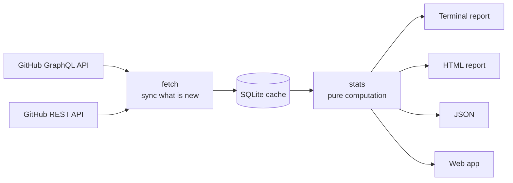
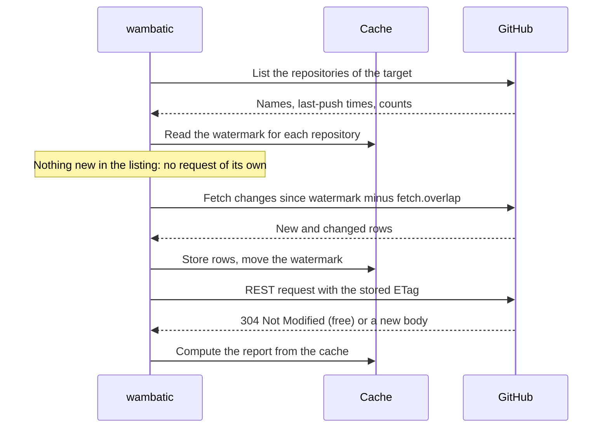

# How wambatic works

How data gets from GitHub to a report, and what limits how fast it goes.

## The pieces

- **fetch** talks to GitHub: the [GraphQL API](https://docs.github.com/en/graphql) lists repositories,
  commits, pull requests and issues, and the [REST API](https://docs.github.com/en/rest) supplies workflow
  runs, releases, stars, forks and the statistics endpoints. It writes what it reads to the cache.
- **The cache** is a [SQLite](https://www.sqlite.org/) file. It is derived data: delete it and the next
  report rebuilds it. See [The cache](guide/cache.md).
- **stats** computes the numbers from the cache alone, with no network. That is why a report from a warm
  cache works offline.
- **The front ends** render the same result: terminal, HTML, JSON and the web app.

## An incremental sync

The first sync of a repository reads its whole history. Later syncs read only what changed.

- **The watermark** is the time of the last sync of a resource. The next sync starts a little before it,
  by `fetch.overlap`, so an item that arrived late is not missed.
- **Conditional requests.** For the REST endpoints wambatic keeps the
  [ETag](https://docs.github.com/en/rest/using-the-rest-api/best-practices-for-using-the-rest-api#use-conditional-requests-if-appropriate)
  GitHub sent. Asking again with it costs nothing against the rate limit when nothing has changed.
- **Full refreshes.** An incremental sync cannot see a deletion, so a resource is read in full again once
  `fetch.full_refresh_after` has passed since its last full read. `--full-refresh` forces it.

## Rate limits

GitHub limits how many requests a token may make: see the
[REST rate limits](https://docs.github.com/en/rest/using-the-rest-api/rate-limits-for-the-rest-api) and the
[GraphQL rate limits](https://docs.github.com/en/graphql/overview/rate-limits-and-node-limits-for-the-graphql-api).
When the limit is reached, `fetch.on_rate_limit` decides what happens:

- `wait` (the default) sleeps until the limit resets and carries on.
- `fail` stops with an error that gives the reset time.

`fetch.workers` sets how many repositories are fetched at once. More is faster and closer to GitHub's
secondary limits, which wambatic answers by retrying up to `fetch.max_retries` times.

## Next

[Targets](guide/targets.md) says what you can report on.
