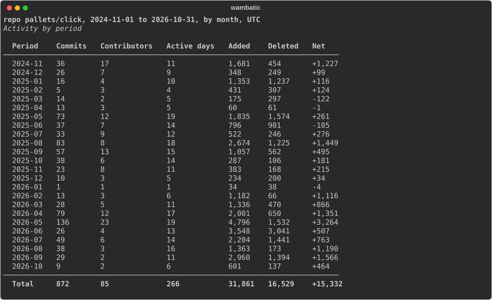
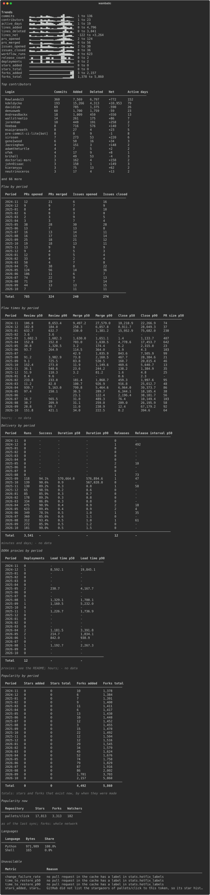
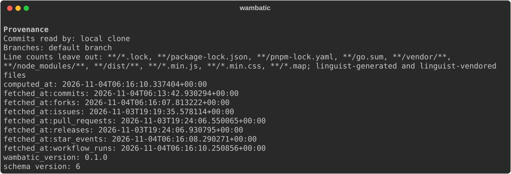

# Getting started

A first report on a real repository, read section by section, then the same data as HTML and JSON.

You need wambatic [installed](install.md) and [a token](token.md).

```shell
wambatic report repo:pallets/click --by month
```

The first run reads the whole history of the repository and may take a while for a large one; later runs
fetch only what is new. The screenshots below were made with all four metric groups, which you ask for
with `--groups activity,flow,delivery,popularity`; the default is `activity,flow`, so your first report
has fewer sections. See [Delivery and DORA](guide/delivery.md) and [Popularity](guide/popularity.md) for
why the other two are off by default.

!!! note
    --8<-- "captured.md"

## Reading the report

### The title and the activity table



The first line names the subject, the date range, the period and the time zone. Activity by period gives,
for each period, commits, contributors, active days, and lines added, deleted and net. A `Total` row ends
the table when there is more than one period. A period that the range cuts short ends in `*`; the caption
under the table says so. See [Activity](guide/activity.md) and [Periods and ranges](guide/periods.md).

The flow, delivery and popularity tables follow in the full report; [The terminal report](guide/terminal.md)
shows each section.

### Trends



With more than one period, Trends draws a sparkline for each metric that has a value in every period,
cropped to the width of your terminal, with the lowest and highest value beside it. Below it, Top
contributors lists the first rows only; the JSON output has every row.

### Provenance



The last section says where the data came from: when the report was computed, when each resource was last
fetched, and the wambatic and cache schema versions. Read it when two reports disagree: the fetch times
tell you which one saw newer data.

Metrics whose inputs are not in the cache appear under Unavailable, with the reason, in place of a table.

Nothing in the output depends on colour: net lines carry an explicit sign, and partial periods carry a
mark.

## Run it again

```shell
wambatic report repo:pallets/click --by month
```

The second run syncs again, because `fetch.max_age` defaults to zero, but a repository with nothing new
costs almost nothing. To skip the network altogether, use the cache alone:

```shell
wambatic report repo:pallets/click --no-fetch
```

or sync only when the cache is older than a day:

```shell
wambatic report repo:pallets/click --max-age 1d
```

[The cache](guide/cache.md) explains how these choices interact.

## The same data as HTML and JSON

```shell
open "$(wambatic report repo:pallets/click --format html)"
wambatic report repo:pallets/click --format json | jq '.series[0].points'
```

The first command writes one HTML file and prints its path, so the shell can open it. The second prints a
JSON document and nothing else on stdout, so [`jq`](https://jqlang.org/manual/) can read it. See
[The HTML report](guide/html.md) and [JSON output](guide/json.md).

## Next

- [How wambatic works](concepts.md) for where the numbers come from.
- [Targets](guide/targets.md) to report on a user or an organisation.
