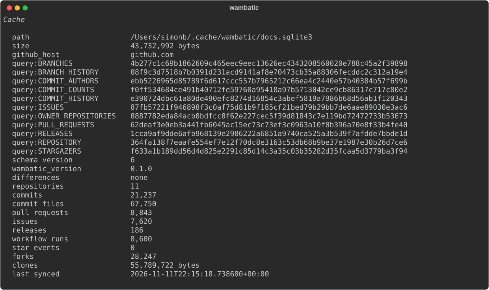
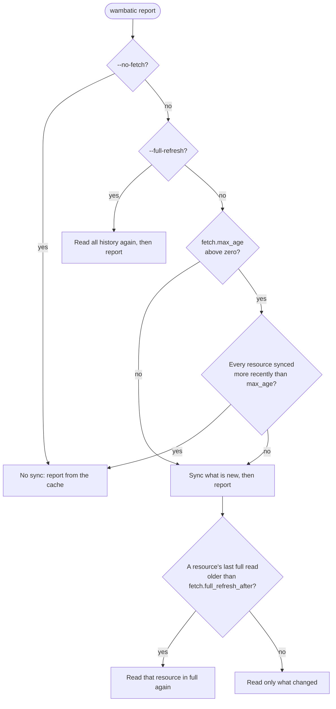

# The cache

Where the cache is, how it decides to sync, and how to inspect or clear it.

```shell
wambatic cache info
```



--8<-- "captured.md"

The cache is a [SQLite](https://www.sqlite.org/) file. It is derived data: everything in it can be read
from GitHub again, so deleting it costs time and requests but loses nothing.

## Where it is

By default `~/.cache/wambatic/cache.sqlite3`. Set `fetch.cache_path` in the
[configuration](config.md) to move it. A leading `~` is expanded.

## `cache info`

`wambatic cache info` prints the path, the size, the identity the cache recorded (the schema version, the
wambatic version and a hash of each query), every key that differs from the wambatic that is running
(with both values), what the cache holds for each kind of record, and when it was last synced. It reads
the file without changing it, so it works on a cache that `report` refuses.

## `cache clear`

```shell
wambatic cache clear
```

This deletes the cache and its `-wal` and `-shm` files without asking. The next report fetches
everything again.

## The version check

wambatic records which version wrote the cache and refuses to read one written by a different version,
rather than mix results from two versions. The report then stops with a one-line error. You have two
ways out:

- `wambatic cache clear`, then run the report again. This is the usual choice: the cache is derived data.
- `--ignore-cache-version` for one run. The override is recorded in the cache and shown as a warning in
  the report.

## Does a report sync?



- `--no-fetch` never touches the network and needs no token. It cannot be combined with `--full-refresh`,
  and a bare `NAME` target needs the network to resolve, so use `user:` or `org:` with it.
- `--max-age 1d` (or `fetch.max_age`) skips the sync when the cache is recent enough. The default of
  zero always syncs.
- A sync reads the repository listing, and a repository with nothing new in the listing costs no request
  of its own.
- `fetch.full_refresh_after` (default `30d`) is the age after which a resource is read in full again, which
  is the only way an item deleted on GitHub leaves the cache. A shorter value is more accurate and costs
  more requests.
- `--full-refresh` reads all history again at once, for example after a force-push you suspect.

## What a first sync costs

The first sync with `--groups delivery` reads every workflow run of each repository, newest first,
about one request for each hundred runs. The first sync with `--groups popularity` reads every star and
every fork the same way. Later syncs ask for the newest page with a conditional request, which GitHub
answers for free when nothing has changed, and read further only when something has. Releases are read
again only when a repository's release count or newest release has changed.

See [How wambatic works](../concepts.md) for the sync in detail and the
[rate limits](https://docs.github.com/en/rest/using-the-rest-api/rate-limits-for-the-rest-api).

## Related

- [Configuration](config.md) for `fetch.*` settings
- [Troubleshooting](troubleshooting.md) for cache errors
- [Recipes](recipes.md) for an offline report
