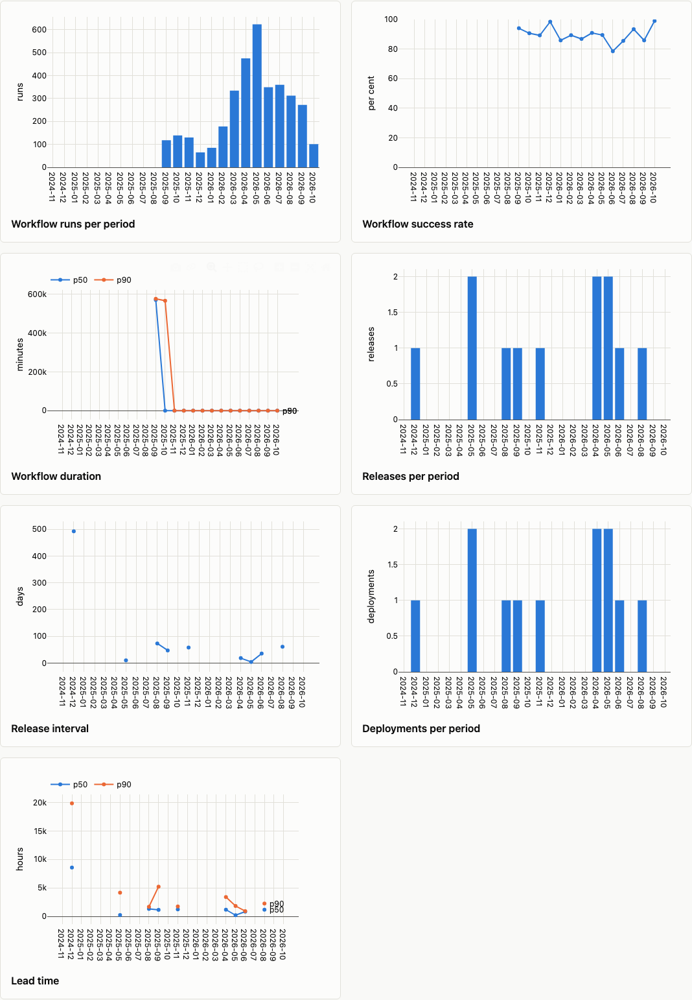
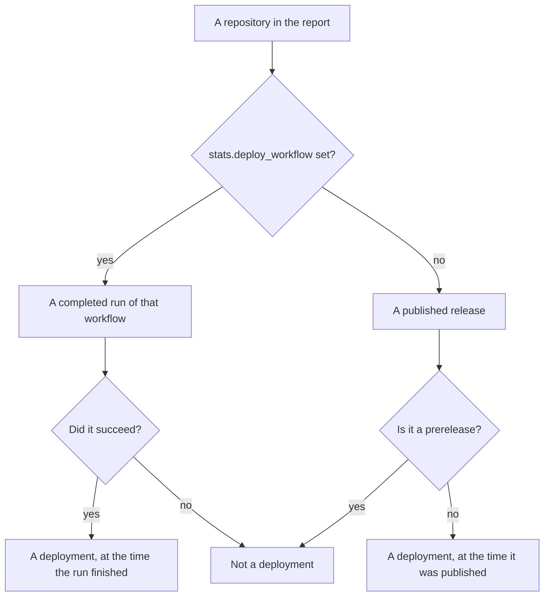
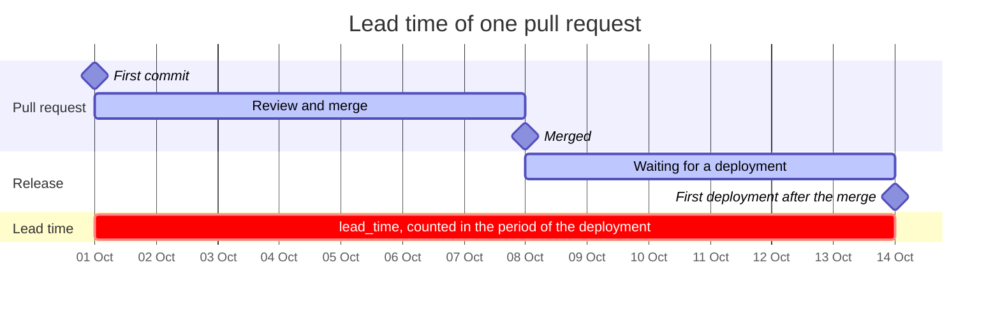
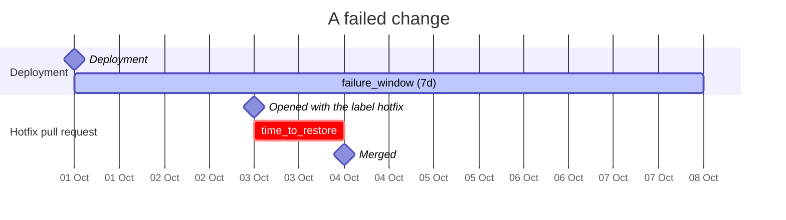

# Delivery and DORA

How a project ships: workflow runs, releases, and proxies for the four DORA keys.

```shell
wambatic report repo:pallets/click --groups delivery
```

`delivery` is not in the default groups, because it reads every workflow run of every repository. Use
`--groups activity,flow,delivery` for everything but popularity. Every metric is defined in the
[metrics reference](../reference/metrics.md).

## Runs and releases

| Metric | What it is |
|--------|------------|
| `workflow_runs` | Workflow runs created in the period, whatever their state |
| `workflow_success_rate` | The share of completed runs that succeeded, shown as a percentage |
| `workflow_duration_p50`, `workflow_duration_p90` | Minutes from a completed run starting to its last update |
| `release_count` | Releases published in the period, prereleases included, drafts left out |
| `release_interval_p50` | Median whole days since the repository's previous release |

- The success rate counts only runs whose conclusion is success, failure, timed out or startup failure.
  Cancelled and skipped runs are not outcomes of the code and are left out of both counts.
- The duration is an approximation: GitHub does not report a run's end time, so wambatic uses the time of
  the run's last update.
- Runs triggered by pull requests are counted like any other.
- A period without a completed run has no success rate or duration, and `p50` and `p90` are as in
  [Flow](flow.md#percentiles).
- For a user target, the runs and releases of the user's own repositories count, whoever made them.



## DORA proxies

[DORA's four keys](https://dora.dev/guides/dora-metrics-four-keys/) are deployment frequency, lead time
for changes, change failure rate and time to restore service. GitHub records none of them, so wambatic
estimates each from what it does record. They are proxies: use them to see a trend, not to compare teams.

| DORA key | Metric |
|----------|--------|
| Deployment frequency | `deployments` |
| Lead time for changes | `lead_time_p50`, `lead_time_p90` |
| Change failure rate | `change_failure_rate` |
| Time to restore service | `time_to_restore_p50`, `time_to_restore_p90` |

### What counts as a deployment



Deployments are counted for each repository. `stats.deploy_workflow` is matched against a run's
workflow file name (`deploy.yml`) or its name. See [Settings](../reference/settings.md).

### Lead time

Lead time runs from a merged pull request's first commit (its creation, when that is not known) to the
first deployment of the same repository at or after the merge. It is placed in the period of the
deployment. A pull request that no deployment has followed yet is not counted.



### Change failure rate and time to restore

A deployment has failed when a pull request of the same repository that carries a label in
`stats.hotfix_labels` follows it within `stats.failure_window` (7 days by default). A deployment whose
window is still open at the end of the range counts as not failed. Time to restore is the time from a
hotfix pull request being opened to being merged, in the period of the merge.



Here the hotfix was opened inside the window, so the deployment counts as failed.

## Unavailable metrics

Each proxy appears only when what it needs is in the cache; otherwise it is listed under Unavailable,
with the reason. `deployments` and the lead time need at least one deployment. The change failure rate
and the time to restore also need a pull request with a hotfix label. That is deliberate: a repository
that never labels its hotfixes would otherwise show a change failure rate of 0%, which reads as good news
and means nothing.

```shell
wambatic report repo:pallets/click --groups delivery --format json |
  jq -r '.tables.unavailable[] | "\(.metric): \(.reason)"'
```

For `repo:pallets/click` this prints that `change_failure_rate` and the two time-to-restore metrics have
no pull request labelled `hotfix`. See [JSON output](json.md).

## Related

- [Flow](flow.md) for the pull-request side of lead time.
- [Settings](../reference/settings.md) for `stats.deploy_workflow`, `stats.hotfix_labels` and
  `stats.failure_window`.
- [The HTML report](html.md) for the charts.
