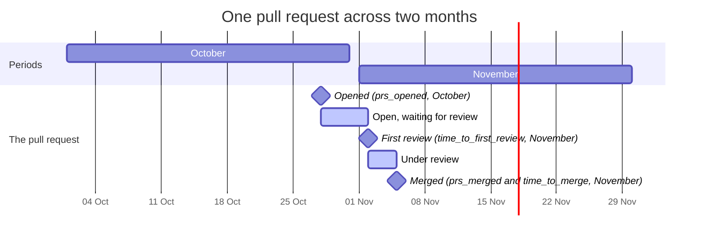

# Flow

Pull requests and issues: how many are opened, merged and closed, and how long that takes.

```shell
wambatic report repo:pallets/click --by month --groups flow
```

`flow` is one of the default groups. The counts and times are defined in the
[metrics reference](../reference/metrics.md).

| Metric | What it is |
|--------|------------|
| `prs_opened`, `prs_merged` | Pull requests created and merged in the period |
| `issues_opened`, `issues_closed` | Issues created and closed in the period |
| `time_to_first_review_p50`, `time_to_first_review_p90` | Hours from a pull request being opened to its first review |
| `time_to_merge_p50`, `time_to_merge_p90` | Hours from a pull request being opened to being merged |
| `time_to_close_p50`, `time_to_close_p90` | Hours from an issue being opened to being closed |
| `pr_size_p50` | Median lines (added plus deleted) of the pull requests merged in the period |

## Each event lands in its own period

An event is placed in the period of its own date in the report time zone, not in the period of the pull
request's opening. A pull request opened in one month and merged in the next is in `prs_opened` for the
first month and in `prs_merged` for the second, and its merge time is counted in the second.



So `time_to_merge_p50` in November includes pull requests that were opened in October. A period in which
nothing was merged has no point for it.

## Percentiles

`p50` is the [median](https://en.wikipedia.org/wiki/Percentile) of the values in the period and `p90`
the 90th percentile: nine in ten values are at or below it. The median shows the usual case and the p90
shows the slow tail. A period with no value has no point (the terminal shows `-`), because a median of
nothing is not zero.

## What is left out, and what is not

- **Review time** leaves out reviews by the pull request's author and by bots, so an automatic
  reviewer does not make every review time a few minutes. A pull request with no other reviewer has no
  review time.
- **Bots' own pull requests and issues are counted.** `stats.bot_logins` only affects contributor
  counts; see [Activity](activity.md).
- **A closed, unmerged pull request** counts only in `prs_opened`.
- **A reopened issue** is open, so it is not in `issues_closed`.
- **A user target** counts only the pull requests and issues that the user opened.

## Related

- [Delivery and DORA](delivery.md) for lead time, which starts where merging ends.
- [Periods and ranges](periods.md) for how periods are cut.
- [Metrics](../reference/metrics.md) for every definition.
