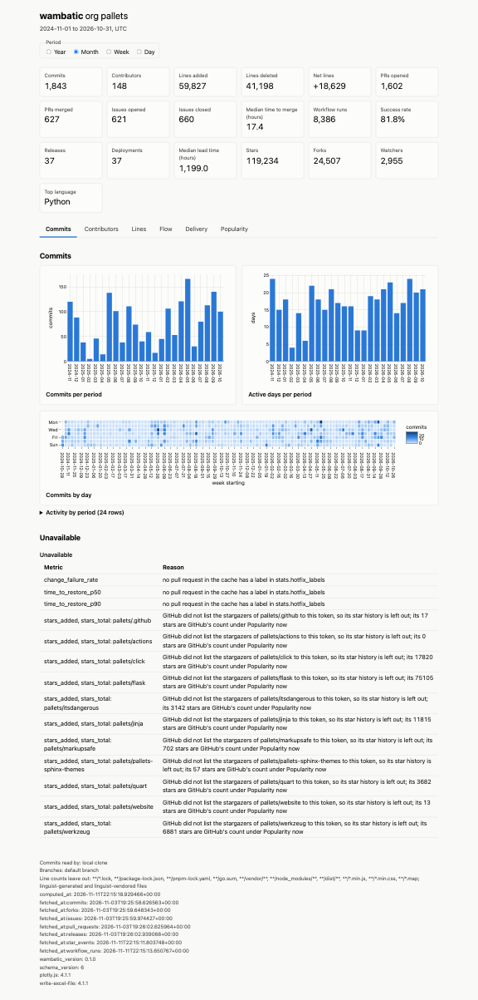
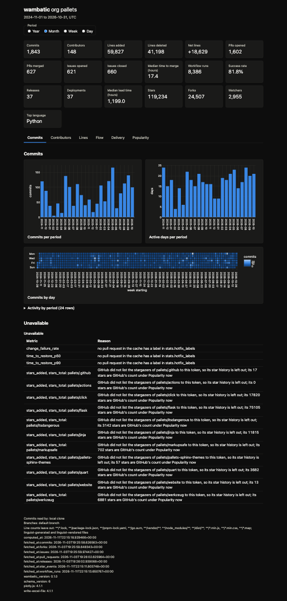
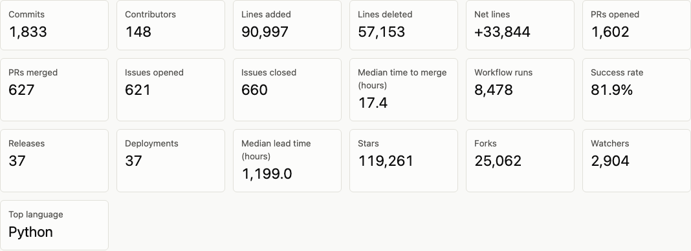
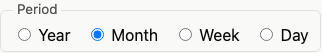
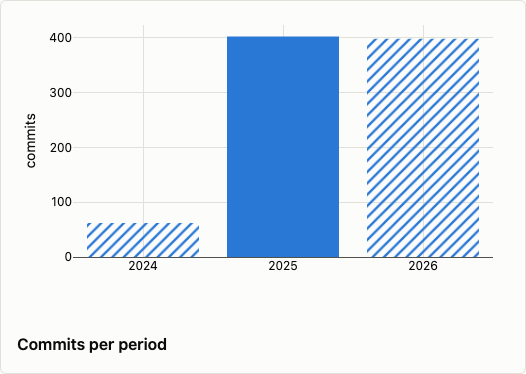
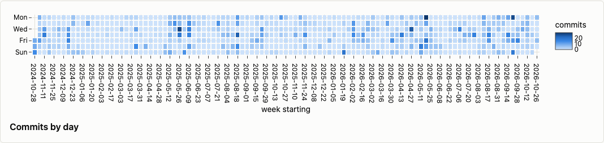
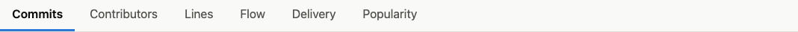
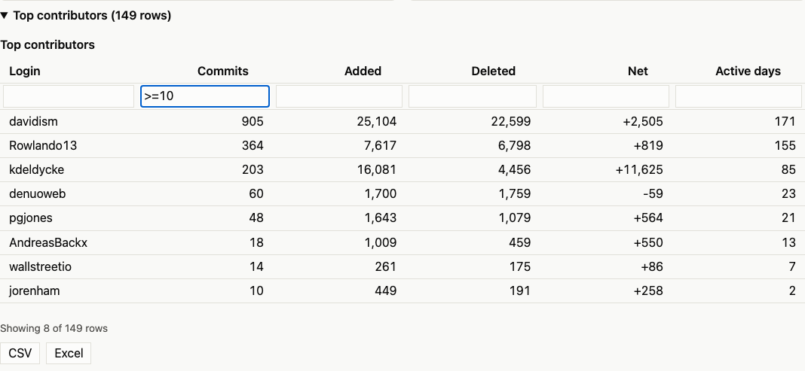

# The HTML report

A tabbed web page with tiles, charts and tables, beside an assets folder, that opens from disk.

```shell
open "$(wambatic report org:pallets --format html)"
```

The command writes one page and an assets folder beside it, and prints the page's path on stdout, so a
script can capture it. The page has summary tiles, then a tab for each section (commits, contributors,
lines, flow, delivery and popularity, for the groups you asked for). The tabs hold a chart for each
measure, whole-range charts (top contributors, by repository and by author, and the languages), a calendar
of commits by day, and the same tables as the [terminal report](terminal.md), which you can collapse, sort,
filter and export.

!!! note
    --8<-- "captured.md"

## Light and dark

By default the page follows the viewer's light or dark setting and changes with it. Set
`report.html_theme` to `light` or `dark` to fix it; see [Configuration](config.md).





The charts use one colour set for each theme and never rely on colour alone.

## The tiles



The tiles show the totals for the whole range.

## Switching period



The page has a Year, Month, Week and Day switch. It does not need the network, or wambatic, to change
the period: the page carries the data for every period. `--by` picks the period shown when the page
opens (default `month`). `--by total` is an error here, because the tiles already show the totals.

## Partial periods



A period that the range cuts short is hatched in bar charts, drawn with open markers in line charts,
and named in the chart's caption. See [Periods and ranges](periods.md).

## The commit calendar



A calendar of commits by day, one cell for each day of the range.

## Tabs



The tab bar sits under the tiles. Click a tab, or use the left and right arrow keys, Home and End. The
address of the page changes to name the tab (`report.html#tab-flow`), so you can send a link that opens on
that tab. The tab ids are `tab-commits`, `tab-contributors`, `tab-lines`, `tab-flow`, `tab-delivery` and
`tab-popularity`; a tab exists only for a group in the report. Without script, the tab bar is hidden and
every section shows one after another.

## Tables

Every table is in a block you open and close by clicking its title. A table of more than ten rows starts
closed, and its title says how many rows it holds.

- **Sort**: click a column heading; click again to reverse, and once more to restore the original order.
  Numbers sort as numbers, not as text.
- **Filter**: type in the box under a heading. A text column keeps rows that contain the text, ignoring
  case. A number column takes `N` or `=N` (equal), `>N`, `>=N`, `<N`, `<=N`, or `A..B` (from A to B,
  inclusive). A number may have `,` separators and a `%`. A box that matches none of these forms is marked
  as invalid and filters nothing. Filters on several columns must all match. The line under the table says
  `Showing 37 of 412 rows`, and the total row is marked `Total (all rows)` while a filter is on, because
  it is not the total of the rows shown.
- **Export**: the CSV and Excel buttons under the table save the rows that are shown (sorted and filtered
  as you see them) with the headings. Numbers are written as numbers, and the CSV opens in Excel with
  non-ASCII names intact. A text cell that starts with `=`, `+`, `-` or `@` gets a leading `'` so a
  spreadsheet does not run it as a formula. A failed export shows one line and saves nothing.



## Where the files go

- `--out PATH` is a file, or an existing directory to write into. Without it the file goes in
  `report.out_dir`.
- The file is named `repo-OWNER-NAME.html`, `user-NAME.html` or `org-NAME.html`.
- The assets folder, `wambatic-assets-HASH`, is written in the same directory. Its name carries a hash of
  its contents, so a newer wambatic adds a folder beside an old one and never changes it, and every page
  loads the files it was made with. Reports written into one directory share a folder.
  An existing folder is reused only when its files are exactly the ones this wambatic writes; one that
  differs (edited, or put there by someone else) stops the run with `cannot write PATH: it exists and
  does not hold this version's files; remove it`, and no page is written.
- Missing directories are created and an existing file is replaced.
- The write is atomic: a failed write leaves the earlier file as it was, and no partial file. The folder
  is written first, so no page points at a folder that is missing.
- `--out` is an error with another format.

## Offline and shareable

The page and its folder hold their own copy of [plotly.js](https://plotly.com/javascript/) and make no
request, so they open from disk and can be hosted together, for instance on GitHub Pages. The folder is
megabytes in size for that reason.

**Keep the page beside its folder.** To send a report, send both, or zip them together; attaching the page
alone to an issue loses the charts, tabs and styles. A page opened without its folder says so at the top:
"This report's files (wambatic-assets-HASH) did not load; keep the page beside that folder." The tiles and
tables still show, unstyled.

Per-period charts show the total series only. The breakdown by repository and by author is for the whole
range.

## Related

- [Delivery and DORA](delivery.md) and [Popularity](popularity.md) for their charts.
- [Recipes](recipes.md) for a nightly report.
- [The web app](web.md) serves this same page.
