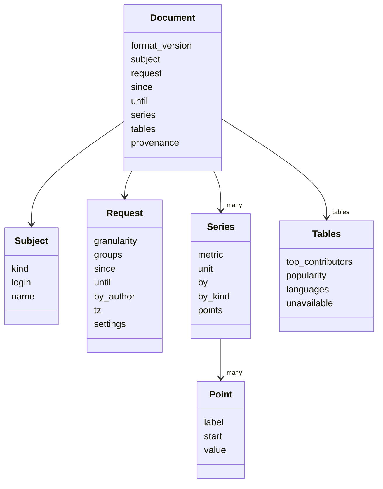

# JSON output

The shape of the JSON document that `--format json` writes, and how to query it.

```shell
wambatic report repo:pallets/click --format json --since 2026-08-01 --until 2026-10-31 | jq '.series[0]'
```

The document goes to stdout and the logs to stderr, so a pipe sees only JSON. The web app's
`/api/stats` route returns the same document; see [The web app](web.md).

## An annotated example

This is a real document, cut down by hand: `repo:pallets/click`, `--by month`, `--groups activity,flow`,
from `2026-08-01` to `2026-10-31`. Elisions are marked `...`; the keys and values shown are as written.

!!! note
    --8<-- "captured.md"

```js
{
  "format_version": 1, // (1)!
  "subject": {"kind": "repo", "login": "pallets", "name": "click"}, // (2)!
  "request": { // (3)!
    "granularity": "month",
    "groups": ["activity", "flow"],
    "since": "2026-08-01",
    "until": "2026-10-31",
    "by_author": false,
    "tz": "UTC",
    "settings": {
      "bot_logins": ["dependabot[bot]", "renovate[bot]"],
      "deploy_workflow": null,
      "exclude_merge_commits": true,
      "failure_window": "604800s",
      "hotfix_labels": ["hotfix"]
    }
  },
  "since": "2026-08-01", // (4)!
  "until": "2026-10-31",
  "series": [ // (5)!
    {
      "metric": "commits",
      "unit": "count",
      "by": null, // (6)!
      "by_kind": null,
      "points": [
        {"label": "2026-08", "start": "2026-08-01", "value": 38},
        {"label": "2026-09", "start": "2026-09-01", "value": 27},
        {"label": "2026-10", "start": "2026-10-01", "value": 1}
      ]
    },
    {
      "metric": "time_to_merge_p50",
      "unit": "hours",
      "by": null,
      "by_kind": null,
      "points": [
        {"label": "2026-08", "start": "2026-08-01", "value": 31.13111111111111}, // (7)!
        ...
      ]
    },
    ...
  ],
  "tables": { // (8)!
    "top_contributors": [
      {"login": "Rowlando13", "commits": 37, "lines_added": 496, "lines_deleted": 443,
       "lines_net": 53, "active_days": 22},
      ...
    ],
    "unavailable": [] // (9)!
  },
  "provenance": { // (10)!
    "schema_version": "4",
    "wambatic_version": "0.1.0",
    "fetched_at:commits": "2026-11-01T08:31:29.956551+00:00",
    "computed_at": "2026-11-01T08:58:02.039231+00:00",
    "timezone": "UTC",
    "partial_buckets": "",
    ...
  }
}
```

1. The version of this document format. It changes only when the shape does, so a script can check it
   before reading anything else.
2. `kind` is `user`, `org` or `repo`. For a repository, `login` is the owner and `name` the repository.
   For a user or organisation `name` is `null`.
3. What was asked for, after the defaults were filled in. `settings` holds the `stats.*` settings that
   shaped the numbers (the time zone is in `tz`), with durations written as `<seconds>s`.
4. The range that was resolved, both days inclusive. With no `--since` it is the day the first period
   holding data starts.
5. One entry for each metric of the requested groups, in the order of the
   [metrics reference](../reference/metrics.md).
6. `by` and `by_kind` are both `null` for a total series. With `--by-author` a series has `by_kind`
   `author` and `by` the login. An organisation or user target also has per-repository series, with
   `by_kind` `repo` and `by` the `owner/name`.
7. Values are integers for the units `count`, `days` and `lines`, and numbers with a fraction for
   the rest. A period with no value has no point at all: look for the label, do not expect a `null`.
8. Tables over the whole range. `top_contributors` is always present; `popularity` and `languages`
   appear with the `popularity` group.
9. Metrics whose inputs are not in the cache, each as `{"metric", "reason"}`. See
   [Delivery and DORA](delivery.md).
10. Where the data came from: the cache schema and wambatic versions, a `fetched_at:` time for each
    kind of record, a `query:` hash for each GraphQL query, and `computed_at`. `partial_buckets` lists
    the labels of the [partial periods](periods.md), joined by commas.

## The objects



## jq recipes

These use [jq](https://jqlang.org/manual/). Each was run against the document above, extended to the
`activity`, `flow`, `delivery` and `popularity` groups where a recipe needs them.

The points of one metric, as `label value` lines:

```shell
wambatic report repo:pallets/click --format json |
  jq -r '.series[] | select(.metric == "commits") | .points[] | "\(.label) \(.value)"'
```

The busiest period for a metric:

```shell
wambatic report repo:pallets/click --format json |
  jq '.series[] | select(.metric == "commits") | .points | max_by(.value)'
```

Every metric's most recent point:

```shell
wambatic report repo:pallets/click --format json |
  jq -r '.series[] | select(.by == null) | "\(.metric)\t\(.points[-1].label)\t\(.points[-1].value)"'
```

The top five contributors:

```shell
wambatic report org:pallets --format json |
  jq -r '.tables.top_contributors[:5][] | "\(.login)\t\(.commits)"'
```

Each author's commits in the range, with `--by-author`:

```shell
wambatic report org:pallets --by-author --format json |
  jq -r '.series[] | select(.by_kind == "author" and .metric == "commits")
         | "\(.by)\t\([.points[].value] | add)"'
```

The metrics that could not be computed, and why:

```shell
wambatic report repo:pallets/click --groups delivery --format json |
  jq -r '.tables.unavailable[] | "\(.metric): \(.reason)"'
```

When the data was last read from GitHub:

```shell
wambatic report repo:pallets/click --format json |
  jq -r '.provenance | to_entries[] | select(.key | startswith("fetched_at:")) | "\(.key) \(.value)"'
```

## Related

- [The terminal report](terminal.md) and [The HTML report](html.md) for the same data to read.
- [Metrics](../reference/metrics.md) for every series name, unit and definition.
- [Periods and ranges](periods.md) for `partial_buckets`.
