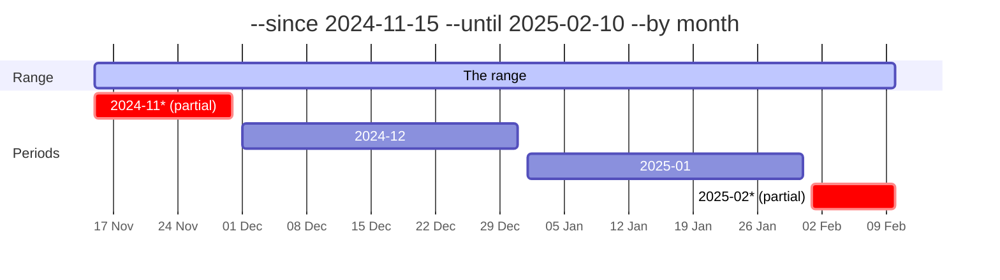

# Periods and ranges

How wambatic cuts a date range into periods, and what a partial period is.

```shell
wambatic report repo:pallets/click --by week --since 2026-09-01 --until 2026-10-15 --tz Europe/Berlin
```

## The options

| Option | Default | Meaning |
|--------|---------|---------|
| `--by year\|month\|week\|day\|total` | `month` | The period to bucket by |
| `--since YYYY-MM-DD` | the first commit | First day, inclusive, in the report time zone; not before 2008-01-01 |
| `--until YYYY-MM-DD` | today | Last day, inclusive, in the report time zone; not after tomorrow in that zone |
| `--tz ZONE` | `stats.timezone` (`UTC`) | An [IANA time zone](https://www.iana.org/time-zones) such as `Europe/Berlin` |

`--by total` gives one row for the whole range, so there are no trends to draw and the HTML report
rejects it: its tiles already show the totals.

Weeks are [ISO weeks](https://en.wikipedia.org/wiki/ISO_week_date): they start on Monday, and a week
belongs to the year that holds its Thursday, so the first days of January can fall in the last week of the
previous year.

## The time zone

Every event is placed in the period of its own date **in the report time zone**. A commit made at 23:30
UTC on 31 October is in October with `--tz UTC` and in November with `--tz Europe/Berlin`. The same
holds for the first and last day of the range: `--since` and `--until` are days in that zone. An unknown
zone is an error.

## Commits in their authors' zones

By default (`--commit-tz report`, or `stats.commit_timezone` set to `report`) a commit is dated in the
report zone like every other event. With `--commit-tz author` each commit is dated on the calendar its
author saw, and every other record (pull requests, issues, releases, runs) stays in the report zone.

A commit's author zone is the first of these that applies:

1. the zone `stats.author_timezones` gives for the author's login (see [Configuration](config.md));
2. the UTC offset git recorded when the commit was made, for a repository read by clone;
3. the report zone.

For example, a commit made on Monday 2 November at 01:00 +09:00 is stored as Sunday 1 November 16:00 UTC.
In a UTC report it is on Sunday by default and on Monday with `--commit-tz author`, and it is inside
`--since 2026-11-02` only in the second case. Bucket labels, the partial-period marks and every series
that is not made of commits are unchanged, and the default `until` is still today in the report zone.

GitHub's API gives commit times in UTC without the author's offset, so a repository that is not cloned has
no offset. Its commits are dated in the report zone, unless `stats.author_timezones` names the author, and
the report lists the repository in its unavailable section as `commit dates: owner/name`. The report
title names both zones: "commits in authors' zones, other events in" the report zone.

## Partial periods

A range rarely starts on the first day of a period or ends on the last. The first and last periods are
then **partial**: they hold only part of a period's days, so they look small next to the whole ones.
wambatic marks them so you do not read a drop into the trend.



- In the terminal report a partial period ends in `*`, and the caption under the table says so.
- In the HTML report a partial period is hatched in bar charts, drawn with open markers in line charts,
  and named in the chart's caption.
- In the JSON output the provenance lists them under `partial_buckets`, as the period labels
  joined by commas; see [JSON output](json.md).

If you want only whole periods, choose `--since` and `--until` that fall on period boundaries.

## Related

- [Targets](targets.md) for what the range is applied to.
- [The terminal report](terminal.md) and [The HTML report](html.md) for how partial periods are drawn.
- [Command line](../reference/cli.md) for every option.
