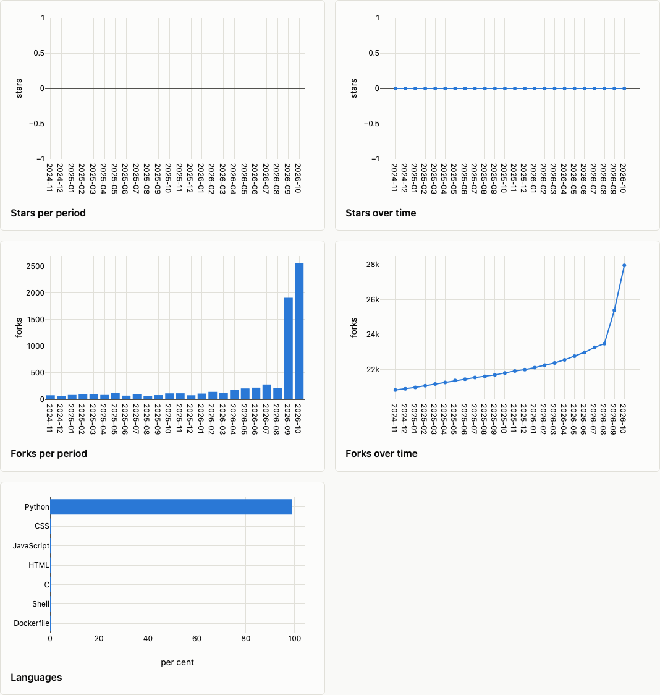
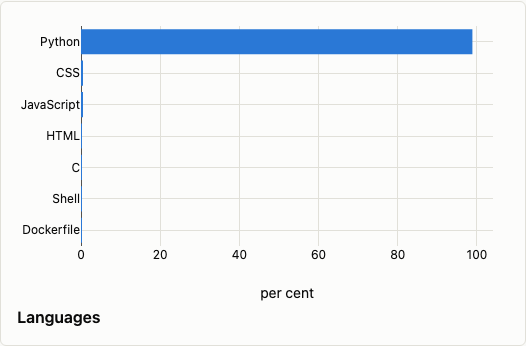

# Popularity

Stars, forks, watchers and languages: how a project is growing, and what it is written in.

```shell
wambatic report org:pallets --groups popularity
```

`popularity` is not in the default groups, because the first sync reads every star and every fork.
Add it with `--groups`, for instance `--groups activity,flow,delivery,popularity` for everything.

| Metric | What it is |
|--------|------------|
| `stars_added` | Stars given in the period, by the date they were given |
| `stars_total` | The stars that exist now, counted by when they were given, up to the end of the period |
| `forks_added` | Direct forks made in the period, by the date they were made |
| `forks_total` | The forks that exist now, counted by when they were made, up to the end of the period |

See the [metrics reference](../reference/metrics.md) for the definitions.

## The totals are cumulative

A period's total is the events before the range plus those up to the end of the period, so totals do not
add up over periods. They count what exists now: a star that was later removed is in none of them.

## The charts



The [HTML report](html.md) draws the added and total series as charts. In this capture the star charts
are flat at zero: GitHub did not list the stargazers to the token that made it, so there was no star
history (see the last section). The fork charts show the series as they are drawn when the data exists.

## Popularity now and languages

Two tables go with the series.

**Popularity now** lists GitHub's own star, fork and watcher counts for each repository at the last
sync, most starred first. The fork count is the whole network. Watchers exist only as this current
count: GitHub does not say when anyone started watching.

**Languages** adds up the bytes of the largest languages GitHub reports for each repository, shown as a
share of the total. With more than ten languages the table and the chart show the largest nine and one
`Other` row for the rest; the [JSON output](json.md) has every row. It is a snapshot of the last sync,
not a history.



## The cost of the first sync

The first sync with `--groups popularity` reads every star, newest first, about one request for each
hundred, and lists every fork the same way, so a popular repository costs many requests against your
[rate limit](../concepts.md). Later syncs compare the listed counts with the cache and read only the
newer events. A count that has fallen (a star removed, a fork deleted) makes wambatic read that
repository's stars or forks again from the start.

If GitHub will not list the stargazers to your token, the star series are left out and the Unavailable
section says why; the star count under Popularity now is still shown. See [Troubleshooting](troubleshooting.md).

For a user target, every star and fork of the user's own repositories counts.

## Related

- [The HTML report](html.md) and [The terminal report](terminal.md) for how it is drawn.
- [The cache](cache.md) for refreshing the history.
