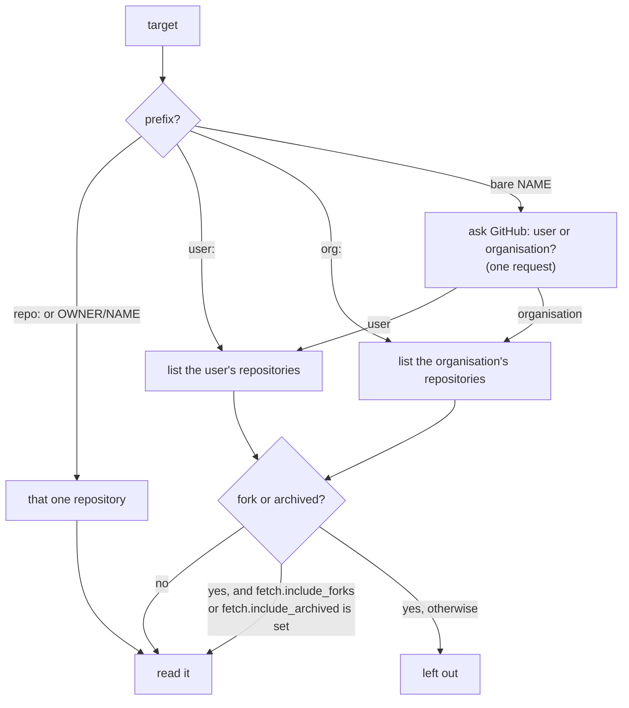

# Targets

How to name the user, organisation or repository to report on.

```shell
wambatic report org:pallets
```

The first argument of `report` and `serve` is the target. It says which repositories wambatic reads from
GitHub and reports on.

| Target | Meaning |
|--------|---------|
| `user:NAME` | The repositories owned by a user, counting only that user's own commits |
| `org:NAME` | The repositories owned by an organisation |
| `repo:OWNER/NAME` or `OWNER/NAME` | One repository |
| `NAME` | Asks GitHub whether `NAME` is a user or an organisation |

Prefixes are lower case. A user, organisation or owner `NAME` is 1 to 39 letters, digits and `-`; a
repository `NAME` is 1 to 100 letters, digits, `.`, `_` and `-`. A malformed target is an error before
anything is fetched.

## From a target to the repositories that are read



## What each target counts

**A repository** (`repo:pallets/click`, or just `pallets/click`) reports on that repository alone. Naming
it directly always reads it, even if it is a fork or archived: you asked for it.

**An organisation** (`org:pallets`) reports on every repository the organisation owns. The report has a
By repository table that splits the totals by repository; add `--by-author` for a By author table too.

**A user** (`user:octocat`) reports on the repositories the user owns, and counts only commits made by
that user. `--by-author` is not
available for a user target, because every commit counted is already the user's.

**A bare name** (`octocat`) costs one request to find out which of the two it is, so it cannot be used
with `--no-fetch`, which makes no request at all. Use `user:` or `org:` there. Prefer the prefix in
scripts too: it saves the request and says what you meant.

## Forks and archived repositories

A user or organisation target leaves out [forks](https://docs.github.com/en/pull-requests/collaborating-with-pull-requests/working-with-forks/about-forks)
and [archived repositories](https://docs.github.com/en/repositories/archiving-a-github-repository/archiving-repositories),
since their history is usually someone else's. To include them, set `fetch.include_forks` or
`fetch.include_archived` in the [configuration](config.md); see [Settings](../reference/settings.md) for
their defaults.

## Private repositories

A target that names private repositories needs a token that can read them; see
[The GitHub token](../token.md) for the scopes.

## Related

- [Periods and ranges](periods.md) for the date range of a report.
- [The cache](cache.md) for what is read from GitHub and when.
- [Command line](../reference/cli.md) for every option.
