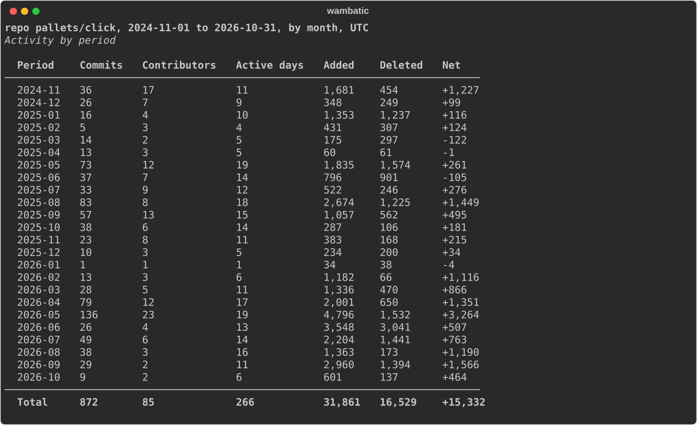
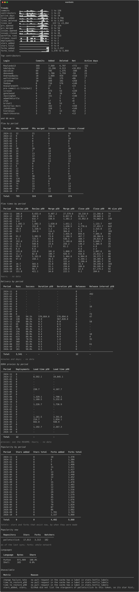
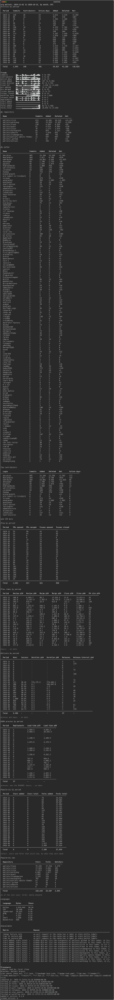
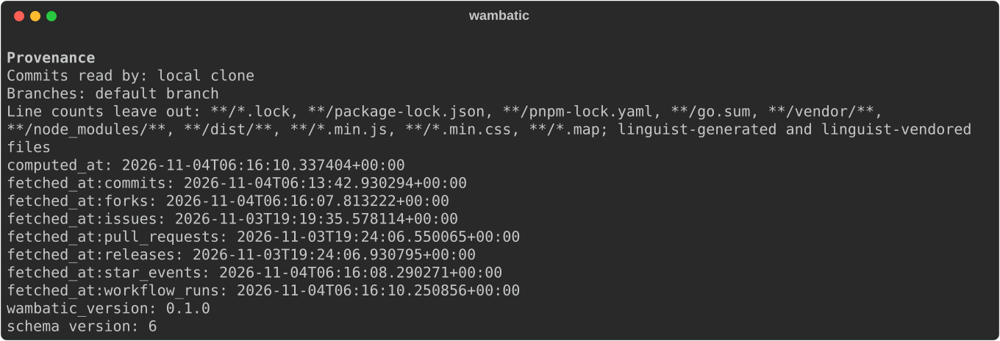

# The terminal report

Every section of the default report, in the order it is printed.

```shell
wambatic report repo:pallets/click --by month --groups activity,flow,delivery,popularity
```

`--format terminal` is the default. The screenshots below were made with all four metric groups; the
default groups, `activity,flow`, print fewer sections.

!!! note
    --8<-- "captured.md"

## Sections in output order

1. A title line with the subject, the date range, the period and the time zone.
2. **Activity by period**: commits, contributors, active days, and lines added, deleted and net for each
   period, with a `Total` row when there is more than one period.
3. **Trends**, when there is more than one period (so not with `--by total`).
4. **By repository** for a user or organisation, and **By author** with `--by-author`.
5. **Top contributors**, the first rows only.
6. **Flow by period** and **Flow times by period**.
7. With `--groups delivery`: **Delivery by period** and **DORA proxies by period**.
8. With `--groups popularity`: **Popularity by period**, **Popularity now** and **Languages**.
9. **Unavailable**: metrics whose inputs are not in the cache, with the reason.
10. **Provenance**: where the data came from.

### Title and Activity by period



A period that the range cuts short ends in `*`; the caption under the table explains it. See
[Periods and ranges](periods.md) and [Activity](activity.md).

### Trends and the tables that follow



Trends draws a [sparkline](https://en.wikipedia.org/wiki/Sparkline) for each metric that has a value in
every period, cropped to the width of your terminal, with the lowest and highest value beside it. The
tables after it are Top contributors, [Flow](flow.md), [Delivery and DORA](delivery.md) and
[Popularity](popularity.md), each as a table with one row for each period.

Top contributors lists only the first rows and ends with "and N more"; the [JSON output](json.md) has
every row.

### By repository and By author

An organisation or user target adds a By repository table, and `--by-author` adds By author:

```shell
wambatic report org:pallets --by-author
```



### Provenance



Read this when two reports disagree: the fetch times tell you which one saw newer data. The wambatic and
cache schema versions are listed here too.

## Colour and width

Nothing in the output depends on colour: net lines carry an explicit sign, `-` stands for a period with
no value, and partial periods carry a `*`. Sparklines are cropped to the terminal width, so a narrow
terminal shows fewer periods of them, not a broken layout. When stdout is not a terminal, for instance
in a pipe or a file, wambatic writes plain text without colour codes.

## Related

- [The HTML report](html.md) and [JSON output](json.md) for the same data in other forms.
- [Metrics](../reference/metrics.md) for the definition of every column.
- [Command line](../reference/cli.md) for every option.
