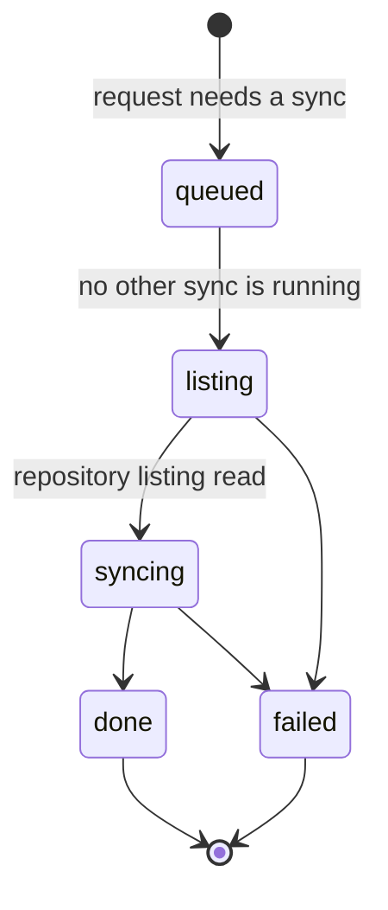
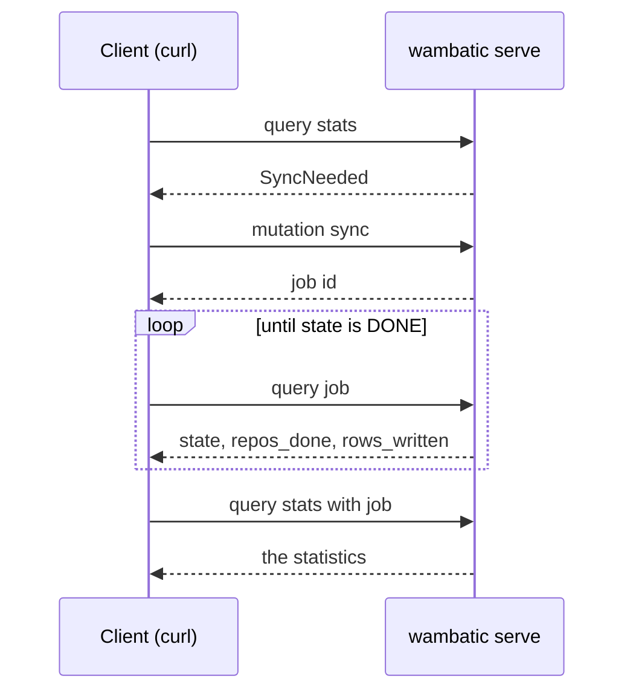
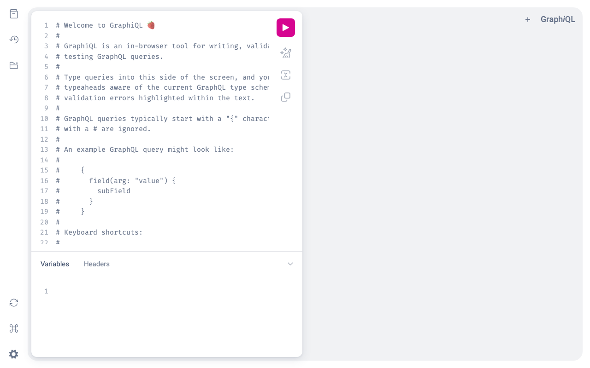
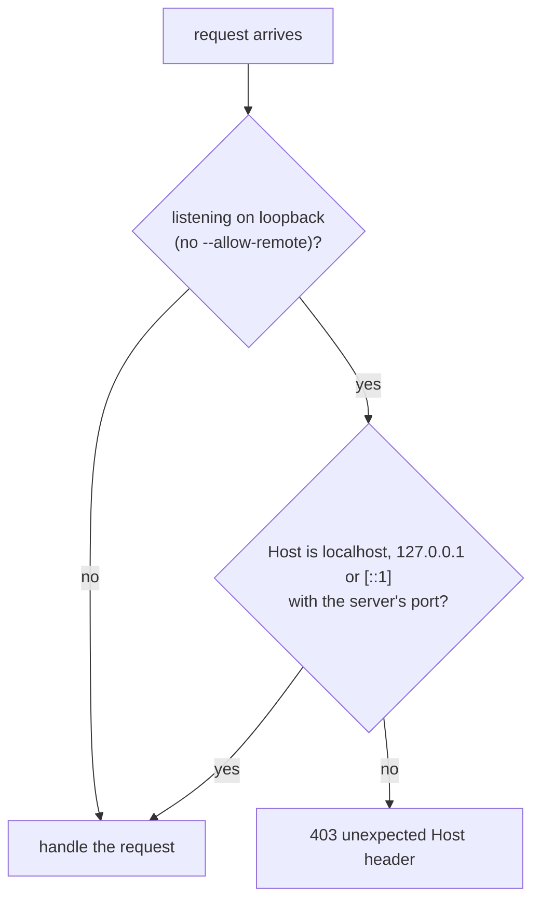

# The web app

Running the local web app and using its form, pages and GraphQL API.

```shell
wambatic serve octocat
```

This starts a web app on your machine and logs the address, `http://127.0.0.1:8000/`, and the URL of the
report for the target you gave. The target is optional: it only fills in the form. Submitting the form
shows the same page as `report --format html`, on the same cache.

!!! note
    --8<-- "captured.md"

## The form


## The progress page

A report that needs a sync does not make the browser wait for it. The server answers at once with a
progress page that shows the state, how many repositories are done and how many rows were written, polls
once a second, and loads the report when the sync is done.


A large organisation can take minutes; the rest of the app stays responsive meanwhile. One sync runs at a
time, so a second target waits its turn, and asking again for a target that is already syncing joins its
sync. If a sync fails, the page shows the message and a link to try again.

A job is in one of these states:



The progress page words `queued` as "Waiting for another sync to finish" and `syncing` as "Syncing
repositories".

## The report


## Commit dates

The form has a "Commit dates" select: the report zone, or each commit's author's zone. It is preset from
`stats.commit_timezone`, and is sent as `commit_tz`, which the `stats` query takes too. See
[Periods](periods.md#commits-in-their-authors-zones).

## How fresh is fresh

The web app syncs on the same rule as `report`: `--max-age` (or `fetch.max_age`) says how recent a sync
may be to skip the network. The default is zero, so every page you open syncs first. For a server you
leave running, `wambatic serve --max-age 1h` is usually what you want. A page you reach from the progress
page does not sync a second time.

## The GraphQL API

`/graphql` is the API of the app. It has a `stats` query, a `sync` mutation and a `job` query. The `stats`
input takes the same parameters as the report (`target`, `by`, `since`, `until`, `groups`, `by_author`,
`tz`, `commit_tz`, and `job`) and returns what `report --format json` prints, as typed fields (`subject`,
`request`, `series`) and as JSON for `tables` and `provenance`. `by` is `TOTAL`, `YEAR`, `MONTH`, `WEEK`
or `DAY`; `TOTAL` is allowed here.

`stats` never starts a sync. When the cache is older than `fetch.max_age`, it answers `SyncNeeded`; you
start the sync with the `sync` mutation, poll `job` until its state is `DONE`, and ask `stats` again with
the job's id as `job`:



A POST must declare `Content-Type: application/json`; anything else is refused with 415. Without that rule
a web page on another site could send a form-encoded request that a browser makes without asking first,
and start a sync with your token.

```shell
# 1. Ask for statistics. A cold cache answers SyncNeeded.
curl -s -H 'Content-Type: application/json' http://127.0.0.1:8000/graphql -d '{
  "query": "query($i: StatsInput!) { stats(input: $i) { __typename ... on SyncNeeded { message } ... on Stats { since until } } }",
  "variables": {"i": {"target": "repo:octocat/Hello-World", "by": "WEEK"}}}'

# 2. Start the sync.
curl -s -H 'Content-Type: application/json' http://127.0.0.1:8000/graphql -d '{
  "query": "mutation($i: StatsInput!) { sync(input: $i) { id state } }",
  "variables": {"i": {"target": "repo:octocat/Hello-World", "by": "WEEK"}}}'
# {"data": {"sync": {"id": "9c1b...", "state": "QUEUED"}}}

# 3. Poll the job until its state is DONE.
curl -s -H 'Content-Type: application/json' http://127.0.0.1:8000/graphql -d '{
  "query": "{ job(id: \"9c1b...\") { state reposDone reposListed rowsWritten error } }"}'

# 4. Ask again with the job.
curl -s -H 'Content-Type: application/json' http://127.0.0.1:8000/graphql -d '{
  "query": "query($i: StatsInput!) { stats(input: $i) { ... on Stats { since until series(metrics: [\"commits\"]) { metric points { label value } } } } }",
  "variables": {"i": {"target": "repo:octocat/Hello-World", "by": "WEEK", "job": "9c1b..."}}}'
```

A failure is a GraphQL error with an `extensions.code` and `extensions.status`:

| Code | Status | Meaning |
|------|--------|---------|
| `BAD_REQUEST` | 400 | A bad parameter |
| `NOT_FOUND` | 404 | A target that does not exist, or has nothing in range |
| `UPSTREAM` | 502 | A GitHub error, for example no token |
| `INTERNAL` | 500 | Anything unexpected; the details are in the server's log |
| `BAD_QUERY` | none | A query that does not match the schema |

The report pages show the same errors as a short page. See [JSON output](json.md) for the document.

## GraphiQL



Opening `/graphql` in a browser shows GraphiQL, an editor for trying queries, with the schema beside it.
It loads its script and style from [jsDelivr](https://www.jsdelivr.com/), so unlike the other pages it
needs a network connection. The `curl` calls above do not.

## Security

The server uses the `GITHUB_TOKEN` of the environment it runs in, and never sends it to the browser. It
listens on loopback only, and refuses any other address unless you pass `--allow-remote` (or set
`report.allow_remote`), because anyone who can reach the port can then read whatever your token can read,
private repositories included, and make wambatic spend your rate limit. On loopback it also answers 403 to
a request whose `Host` header is not `localhost`, `127.0.0.1` or `[::1]` with the port the server listens
on, which stops a web page on another site from reaching it through
[DNS rebinding](https://en.wikipedia.org/wiki/DNS_rebinding). That check is off with `--allow-remote`,
since the names the server is reached by are not known. The app sends no CORS headers, so other sites
cannot read its answers.



## Options

Global options come before the command, as for `report`: `wambatic -v serve ...`. The full table is in
[Command line](../reference/cli.md).

## Stopping

Press Ctrl-C. A running sync is cancelled and resumes where it stopped on the next sync, and the exit
status is 130.

## Related

- [The HTML report](html.md) for the page the server serves.
- [The cache](cache.md) for how syncs are decided.
- [The GitHub token](../token.md) for the token the server uses.
