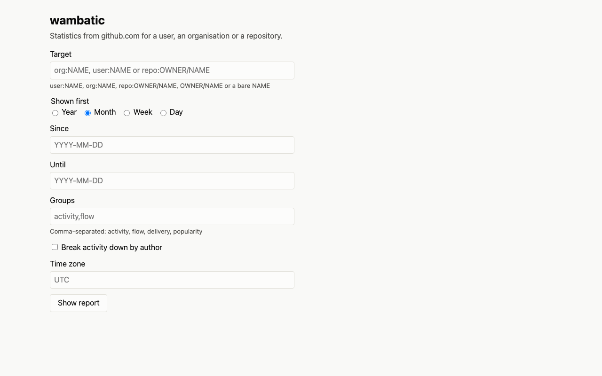
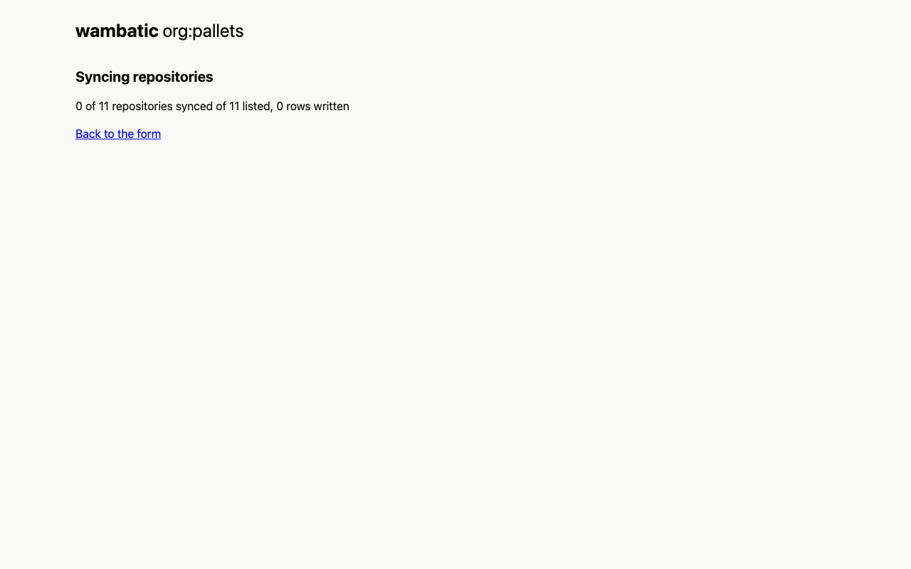
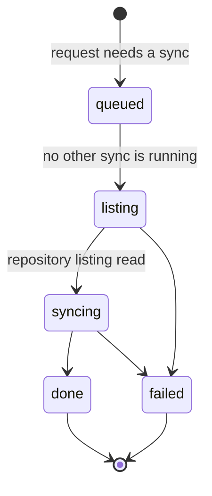
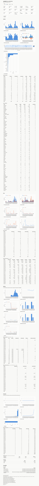
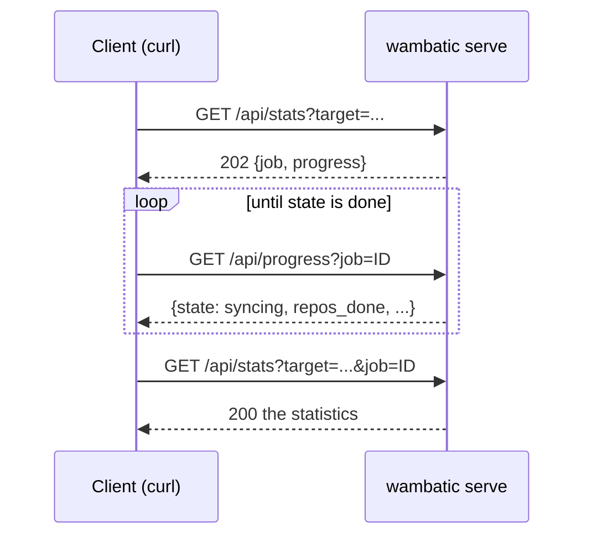
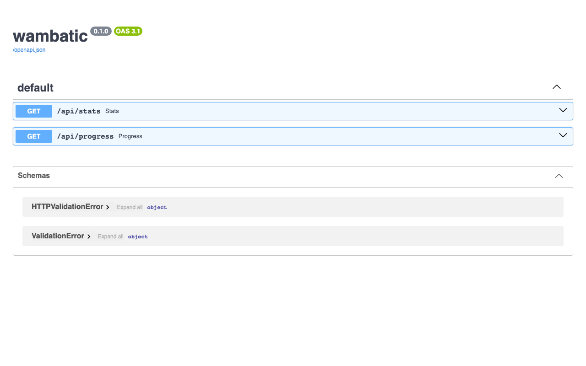
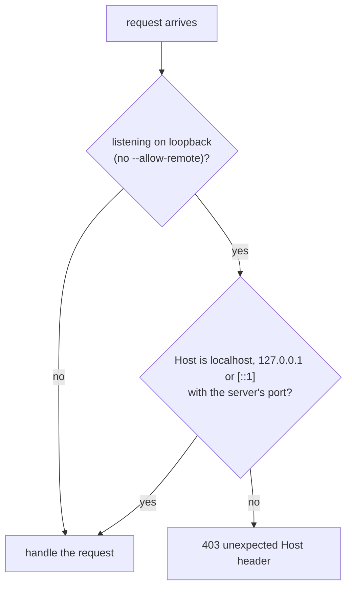

# The web app

Running the local web app and using its form, pages and JSON routes.

```shell
wambatic serve octocat
```

This starts a web app on your machine and logs the address, `http://127.0.0.1:8000/`, and the URL of the
report for the target you gave. The target is optional: it only fills in the form. Submitting the form
shows the same page as `report --format html`, on the same cache.

!!! note
    --8<-- "captured.md"

## The form



## The progress page

A report that needs a sync does not make the browser wait for it. The server answers at once with a
progress page that shows the state, how many repositories are done and how many rows were written, polls
once a second, and loads the report when the sync is done.



A large organisation can take minutes; the rest of the app stays responsive meanwhile. One sync runs at a
time, so a second target waits its turn, and asking again for a target that is already syncing joins its
sync. If a sync fails, the page shows the message and a link to try again.

A job is in one of these states:



The progress page words `queued` as "Waiting for another sync to finish" and `syncing` as "Syncing
repositories".

## The report



## How fresh is fresh

The web app syncs on the same rule as `report`: `--max-age` (or `fetch.max_age`) says how recent a sync
may be to skip the network. The default is zero, so every page you open syncs first. For a server you
leave running, `wambatic serve --max-age 1h` is usually what you want. A page you reach from the progress
page does not sync a second time.

## The JSON routes

`/api/stats` takes the same parameters as the report (`target`, `by`, `since`, `until`, `groups`,
`by_author`, `tz`) and returns what `report --format json` prints. `by=total` is allowed there, and
`by_author` is `1`, `true` or `on`. When a sync is needed it answers 202 with a job to follow, and you ask
again with `job=ID` once `/api/progress` says it is done:



```shell
curl -s 'http://127.0.0.1:8000/api/stats?target=repo:octocat/Hello-World&by=week'
# {"job": "9c1b...", "progress": "/api/progress?job=9c1b..."}
curl -s 'http://127.0.0.1:8000/api/progress?job=9c1b...'
# {"job": "9c1b...", "state": "syncing", "repos_listed": 1, "repos_pending": 1, "repos_done": 0, ...}
curl -s 'http://127.0.0.1:8000/api/stats?target=repo:octocat/Hello-World&by=week&job=9c1b...'
```

Errors are `{"error": "..."}` with status:

| Status | Meaning |
|--------|---------|
| 400 | A bad parameter |
| 404 | A target that does not exist, or has nothing in range |
| 502 | A GitHub error, for example no token |
| 500 | Anything unexpected; the details are in the server's log |

The report pages show the same errors as a short page. See [JSON output](json.md) for the document.

## The API page



`/docs` is a generated page describing the JSON routes. It loads its script and style from
[jsDelivr](https://www.jsdelivr.com/), so unlike the other pages it needs a network connection.

## Security

The server uses the `GITHUB_TOKEN` of the environment it runs in, and never sends it to the browser. It
listens on loopback only, and refuses any other address unless you pass `--allow-remote` (or set
`report.allow_remote`), because anyone who can reach the port can then read whatever your token can read,
private repositories included, and make wambatic spend your rate limit. On loopback it also answers 403 to
a request whose `Host` header is not `localhost`, `127.0.0.1` or `[::1]` with the port the server listens
on, which stops a web page on another site from reaching it through
[DNS rebinding](https://en.wikipedia.org/wiki/DNS_rebinding). That check is off with `--allow-remote`,
since the names the server is reached by are not known. The app sends no CORS headers, so other sites
cannot read its answers.



## Options

Global options come before the command, as for `report`: `wambatic -v serve ...`. The full table is in
[Command line](../reference/cli.md).

## Stopping

Press Ctrl-C. A running sync is cancelled and resumes where it stopped on the next sync, and the exit
status is 130.

## Related

- [The HTML report](html.md) for the page the server serves.
- [The cache](cache.md) for how syncs are decided.
- [The GitHub token](../token.md) for the token the server uses.
