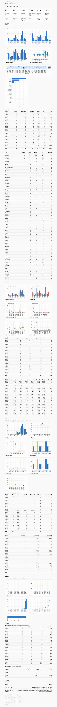

# wambatic

Statistics from github.com for a user, an organisation or a single repository, as a report in your
terminal, as one self-contained HTML page, as JSON or in a web app on your own machine.

```shell
wambatic report repo:pallets/click --format html --by month
```

This reads the history of the repository from the [GitHub API](https://docs.github.com/en/graphql),
keeps it in a local [SQLite](https://www.sqlite.org/) cache, writes one HTML file and prints its path.
Open the file in a browser:



!!! note
    --8<-- "captured.md"

The command needs a GitHub token. [The GitHub token](token.md) says how to get one in a minute.

## Where to start

1. [Install wambatic](install.md) and [get a token](token.md).
2. Read [Getting started](getting-started.md) for a first report, section by section.
3. Read [How wambatic works](concepts.md) to see where the numbers come from.
4. Choose what to report on with [Targets](guide/targets.md) and [Periods and ranges](guide/periods.md).
5. Choose how to see it: [the terminal report](guide/terminal.md), [the HTML report](guide/html.md),
   [the web app](guide/web.md) or [JSON output](guide/json.md).
6. Read what each group of metrics means: [Activity](guide/activity.md), [Flow](guide/flow.md),
   [Delivery and DORA](guide/delivery.md) and [Popularity](guide/popularity.md).
7. Look after the data and the settings: [The cache](guide/cache.md), [Configuration](guide/config.md),
   [Recipes](guide/recipes.md) and [Troubleshooting](guide/troubleshooting.md).

The [reference](reference/cli.md) lists every option, setting and metric, and [Limits](limits.md)
says what wambatic does not do.

## Why wambatic

- **One tool, four front ends.** The same numbers appear in the terminal, in a page you can attach to an
  issue, as JSON for scripts and in a web app.
- **Only what is new is fetched.** After the first run, a sync reads the changes since the last one, so a
  repeat run is fast and a report from a warm cache works offline.
- **Nothing is hidden behind colour.** Net lines carry a sign and a partial period carries a mark, so the
  output reads the same in a pipe or a screen reader.
- **Your token stays on your machine.** It is never written to the cache, the logs or a report.

## Limits

- Only the default branch's history is read.
- A report uses one time zone.
- GitHub Enterprise Server is not supported.
- The [DORA](https://dora.dev/guides/dora-metrics-four-keys/) figures are proxies, for trends rather than
  comparisons.
- Watchers and languages are snapshots, not histories.

[Limits](limits.md) gives each one with its reason.
