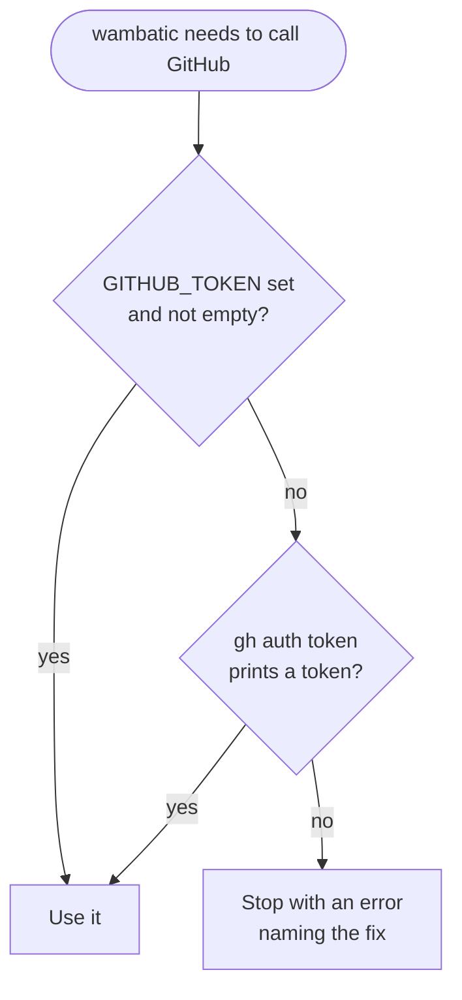

# The GitHub token

What token wambatic needs, how it finds it, and when it needs none.

wambatic reads GitHub through its API, which answers only requests that identify a user. That identity is a
[personal access token](https://docs.github.com/en/authentication/keeping-your-account-and-data-secure/managing-your-personal-access-tokens):
a long string you create in your GitHub settings and that acts with the permissions you give it.

## The quickest way

If you use the [GitHub CLI](https://cli.github.com/) and have run `gh auth login`, there is nothing to do:
wambatic asks `gh auth token` for the token. Otherwise:

```shell
export GITHUB_TOKEN=<token from https://github.com/settings/tokens>
```

## How the token is found



A report that makes no request, with `--no-fetch` or a `--max-age` that the cache already satisfies, needs no
token at all.

## A GitHub Enterprise Server

For a host set with `--github-host`, wambatic never uses `GITHUB_TOKEN`; it looks for `GH_ENTERPRISE_TOKEN`,
then `GITHUB_ENTERPRISE_TOKEN`, then `gh auth token --hostname <host>`. Run `gh auth login --hostname <host>`
once to use the GitHub CLI. See [GitHub Enterprise Server](guide/enterprise.md).

## What the token may do

wambatic only reads. Create a classic token or a fine-grained one.

**Classic token**
([GitHub docs](https://docs.github.com/en/authentication/keeping-your-account-and-data-secure/managing-your-personal-access-tokens#creating-a-personal-access-token-classic)):

| Scope | Needed for |
|-------|------------|
| `public_repo` | Public repositories; enough for most uses |
| `repo` | Private repositories |
| `read:org` | Private membership of an organisation |

**Fine-grained token**
([GitHub docs](https://docs.github.com/en/authentication/keeping-your-account-and-data-secure/managing-your-personal-access-tokens#creating-a-fine-grained-personal-access-token)),
with read access to:

- Repository permissions: Metadata, Contents, Pull requests, Issues and Actions
- Organisation permissions: Members

A fine-grained token reaches only the repositories you select when you create it.

## What wambatic does with it

- The token is never written to the cache, the logs or a report.
- A `GITHUB_TOKEN` that appears in an error message is replaced by `***`.
- The [web app](guide/web.md) uses the token of the environment it runs in and never sends it to the
  browser.

## Next

[Getting started](getting-started.md) makes a first report.
